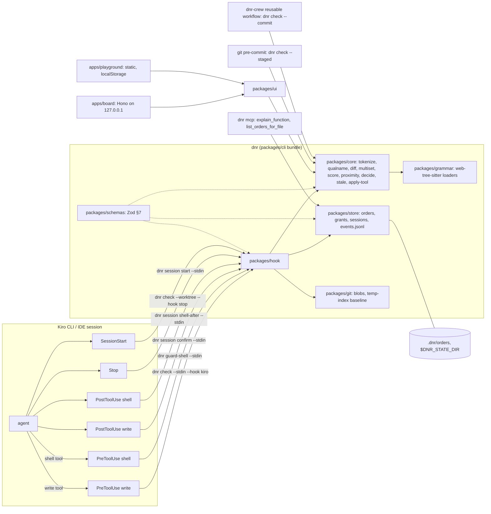

# Design Document: dnr-check

## Overview

DNR turns approved revert orders into write-time enforcement. Kiro calls `dnr` from six hook files; `dnr` loads the orders, rebuilds the session's proposed state, scores it against each order with the edit-overlap rule (plus proximity when enabled), and answers with an exit code or JSON. The same isomorphic engine runs in the browser Playground and the local board, and at commit time in pre-commit and the Crew check. This design follows plan §4–§8, §10 and §12; where this document and the plan disagree, the plan wins and this document is fixed.

## Architecture

Package boundaries are those of plan §4 and the workspace in this repo. `packages/core` has no `node:*` imports, so P9 parity holds by construction.

## Components and Interfaces

### Hook entry points (`packages/hook`)

| Command                                                 | Hook file                           | Behavior                                                                                                                              | Requirements          |
| ------------------------------------------------------- | ----------------------------------- | ------------------------------------------------------------------------------------------------------------------------------------- | --------------------- |
| `dnr check --stdin --hook kiro`                         | `dnr-pre-write.json`                | Parse stdin (Zod), open or create the session, apply the tool adapter, evaluate tiers, emit exit code / JSON, append an `EventRecord` | R1–R12, DC1, DC5, DC9 |
| `dnr session confirm --stdin`                           | `dnr-post-write.json`               | Compare the written file with `pending_ask.proposed_sha256`; create the `ask` grant                                                   | R13                   |
| `dnr guard-shell --stdin`                               | `dnr-guard-shell.json`              | GS-R1 … GS-R7, take `shell_snapshot`                                                                                                  | DC10                  |
| `dnr session shell-after --stdin`                       | `dnr-post-shell.json`               | Diff `shell_snapshot` against the tree after the call; add changed files to `touched`                                                 | DC10                  |
| `dnr check --worktree --hook stop --max-forced-turns 2` | `dnr-stop-backstop.json`            | Whole-order check over `touched`; order-set hash check; JSON continue decision; always exit 0                                         | DC11, R7              |
| `dnr session start --stdin`                             | `dnr-session-start.json` (optional) | Build `baseline_tree`, bind pending next-session grants, hash the order set                                                           | R4, DC8               |
| `dnr check --staged`                                    | git pre-commit                      | Crossing rule against HEAD, blob-matched grants                                                                                       | DC6                   |

Hook stdin fields beyond `hook_event_name`, `cwd`, `session_id`, `tool_name`, `tool_input` are frozen in `.kiro/steering/hook-contracts.md` after spikes S2, S3, S12 and S15. Until then each adapter accepts every candidate field name and falls to the warn tier on an unknown shape.

### Decision pipeline (pre-write)

1. **Parse.** Zod-validate stdin. On failure: `error_open`, exit 0.
2. **Session.** Key `sha256(session_id)` or the `realpath(cwd)` fallback. If new, build the baseline (temp index, §5.7) and record `orders_hash`.
3. **Protect.** Resolve the target path; if it falls under a protected glob, `deny_protected` (exit 2 in both formats).
4. **Fast path.** If the target file is not covered by any approved or stale order and is not a fingerprint candidate, allow (target p95 < 80 ms). Results are cached by blob SHA.
5. **Propose.** The adapter yields the proposed text; the session's proposed state is the current working state of every file in the order with this write applied.
6. **Score.** For each covered order: tokenize baseline and proposed units, `diffArrays` → A′, R′; edit score with weighted multisets; two-sided rule; small-order rule; missing-unit table; fingerprint lookup; proximity if enabled.
7. **Decide.** Grants first (an applying grant turns the match into `allow_grant` and switches the warn tier off); then match (`block` / `ask`), warn (`warn_block` once per order per session, then `warn_pass`), allow. Mode adjustments from §5.14 apply last.
8. **Emit.** Deny format: stderr in the §6 format, capped at 1,200 characters, exit 2. Ask format: stdout JSON, exit 0. Append one `EventRecord` with `session_patch` and `proposed_text` on block, `warn_block` and `ask`.

Any internal error or timeout at any step → `error_open`, exit 0, `hook.log` entry. Invalid or tampered DNR state is not an internal error (R7 as amended):

- an unreadable or Zod-invalid config falls back to the §7 defaults;
- a garbled session file is replaced by a new session with a fresh baseline;
- orders and hooks are checked against the committed state.

In each case DNR reports the tampering (event and stderr) and keeps enforcing.

### Core engine (`packages/core`)

| Module       | Responsibility                                                                | Plan            |
| ------------ | ----------------------------------------------------------------------------- | --------------- |
| `tokenize`   | tree-sitter leaves → tokens with weights; degraded-parse detection            | §5.1, §5.15     |
| `qualname`   | units, `#n` suffixes, `<body>`, `<module>`, `<default>`; line → smallest unit | §5.2, §5.15     |
| `diff`       | thin `diffArrays` wrapper                                                     | §4              |
| `multiset`   | weighted multiset intersection with repeats                                   | §5.5            |
| `score`      | edit score, two-sided rule, whole-order aggregation                           | §5.5            |
| `proximity`  | 3-shingles, weighted Jaccard, normalization, clamping, pairing                | §5.6            |
| `decide`     | tiers, grants, warn-once, mode downgrades, reason text                        | §5.4, §5.14, §6 |
| `stale`      | stale and re-landed derivation                                                | §5.9            |
| `apply-tool` | tool adapters                                                                 | §5.8            |

Order building and the fingerprint index use these modules; their file I/O lives in `packages/git` and `packages/store`.

### Store (`packages/store`)

Atomic writes (temp file + rename) and per-session locks. Files: `orders/<id>.json` (`Order`), `grants/<order_id>.<session_key>.json` and `<order_id>.pending.json` (`Grant`), `sessions/<key>.json` (`Session`), `events.jsonl` (`EventRecord`), `hook.log`, `cache/` (blob-SHA cache, `fingerprints.json`), `board.json` (live board port).

### Shell guard

GS-R1 … GS-R7 as in §5.10, evaluated over every segment after splitting. GS-R6 is enforced twice: by guard-shell when the agent issues the command, and inside each R6 subcommand by the process-ancestry and Kiro-variable check (variables frozen by S8). GS-R7 reads `board_port` and `$DNR_STATE_DIR/board.json`. Denials are logged separately so arm L can report them.

### Stop backstop

Scores `baseline_tree` vs the working tree for files in `Session.touched` only, so a human's editor changes between turns are never forced back. Skips orders with an applying grant. Forced turns are counted in `stop_forced_turns` and capped (2, or 1 in reduced modes). The reason text names only the agent's own edits and never suggests a checkout.

### Local board and Playground (`packages/ui`, `apps/board`, `apps/playground`)

One React app with two adapters. The board adapter calls the §10 local API with cookie, `Origin` and `X-DNR-CSRF` checks; the Playground adapter keeps a simulated session (fixed baseline, warned set, grants, an "Advance 1 h" clock) in localStorage and runs `@dnr/core` with the browser grammar loader. Routes, states (draft, approved, retired, stale, re-landed, drift, the three empty states) and error banners follow §10. Deploy headers (`application/wasm`, CSP with `'wasm-unsafe-eval'` and the `connect-src` list) live in the Playground's `_headers`.

### MCP server, drafter, power

- `dnr mcp` (stdio, `@modelcontextprotocol/sdk`): two read-only tools that never return A or R tokens. Registered in `.kiro/settings/mcp.json` and `powers/dnr/mcp.json`.
- `dnr draft`: runs `.kiro/agents/dnr-drafter.json` (bundled in the npm package and passed by absolute path in user repos), Zod-validates the JSON, retries twice, caches to `$DNR_STATE_DIR/drafts/` (or `fixtures/drafts/` with `--trial`).
- Power: `powers/dnr/` in the Agent Plugins format, `POWER.md` as the legacy fallback. Hooks and steering are bundled only if S9 shows support; otherwise the skill's first step is `dnr init`.

## Data Models

All records are the Zod schemas in plan §7 (`packages/schemas`): `Order`, `OrderUnit`, `Grant`, `Session`, `Decision`, `EventRecord`, `CaseBundle`, plus the fixture schemas. `Decision` replay uses the canonical projection (no `latency_ms`, no `fast_path`, sorted keys). Config defaults: `{mode: 'enforce', threshold: 0.6, side_min: 0.3, min_order_weight: 8, prox_enabled: false, prox_threshold: 0.5, decision_format: 'deny', session_ttl_minutes: 30, stop_max_forced_turns: 2, board_port: 4317, fingerprint_floor: 0.7}`.

## Error Handling

| Situation                               | Behavior                                                                                           |
| --------------------------------------- | -------------------------------------------------------------------------------------------------- |
| Any internal error or timeout in a hook | allow, `error_open`, `hook.log` (R7) |
| Invalid or tampered config | the §7 defaults (`enforce`, `deny`, τ 0.6); tampering reported; never fail open (R7) |
| Garbled or Zod-invalid session file | new session with a fresh baseline; tampering reported (R7) |
| Order or hook files differ from the committed state | the committed state is used; tampering reported; Stop forces a reporting turn (R7, DC11) |
| Stop handler error                      | exit 0, no forced turn (R7)                                                                        |
| Hook timeout                            | assumed allow (S7 confirms)                                                                        |
| Zod-invalid order file | the committed version (`git show HEAD:<file>`) is used if valid, otherwise it is reported as tampering; `dnr orders verify` exits 65; the board shows the invalid-order banner |
| Unknown tool shape                      | warn tier if a path is present, else allow                                                         |
| `str_replace` with 0 or several matches | allow (the tool will fail)                                                                         |
| Missing git or grammar                  | non-hook commands exit 69; hooks fail open                                                         |

## Testing Strategy

- **Unit:** qualname cases (methods, nested classes, decorators, `#2`, `<body>`, `<module>`, closures), tokenizer weight-0 cases including `a.b → a?.b`, adapters per tool, guard-shell table of 40 or more commands.
- **Properties:** P1–P5, P7, P8 (Phase 4); P3, P10 (Phase 5); P10, P12, P13, P15 (Phase 6); P9 (Phase 7); P11, P14, P16, P17 (Phase 10); TS P1–P5 and P16 (Phase 12). 500 runs locally, 2,000 nightly. First failure recorded in `reports/property-failures.md`.
- **Golden fixtures:** S2 captures turned into `reapply-43933a1dca.json`, `hardneg-typehints.json`, `uncovered.json`, one per tool, `two-file-order.json`, and the hard negatives.
- **Performance:** hyperfine + `scripts/p95.mjs` into `reports/perf.md`.
- **Live checks (Phase 6):** headless cherry-pick denied; `sed` re-application undone by a forced turn while pre-session human edits survive; `python -c` write caught by post-shell and Stop; interactive `ask` confirmed through PostToolUse.
- **Browser:** Playwright parity on three engines, axe, Lighthouse (performance ≥ 90, accessibility 100), board auth matrix, deep links, empty states.
- **Regression gate (Phase 12):** canonical replay of every sealed run is byte-identical before and after Phase 12.

## Traceability

| Requirement   | Plan           | Component                                              | Phase                 |
| ------------- | -------------- | ------------------------------------------------------ | --------------------- |
| R1, R12, DC1  | §5.4, §6       | `decide`, hook pre-write                               | 5                     |
| R2, R3        | §5.4           | `decide`, session `warned`                             | 5                     |
| R4, DC8       | §5.7           | `git` temp index, store sessions                       | 5                     |
| R5, DC5       | §5.5           | `score`, `multiset`                                    | 4                     |
| R6            | §5.4           | hook protect tier                                      | 5                     |
| R7            | §5.11, §5.12   | all hook entry points                                  | 5, 6                  |
| R8            | Phase 5, §5.16 | fast path, cache                                       | 5, 10                 |
| R9            | §5.4, §5.7     | store grants, `decide`                                 | 5                     |
| R10           | §5.9           | `stale`                                                | 4                     |
| R11, DC14     | §5.5, §5.16    | fingerprint index                                      | 5 (warn fallback), 10 |
| R13           | §5.7           | session confirm                                        | 6                     |
| R14, R15      | §12.5          | `dnr check --commit`, `dnr init --crew`, dnr-crew repo | 12                    |
| DC2, DC3, DC4 | §5.1–5.3       | `tokenize`, `qualname`, orders build                   | 2, 4                  |
| DC6           | §5.5, §5.7     | `dnr check --staged/--commit`                          | 5, 6                  |
| DC7           | §5.6           | `proximity`                                            | 10                    |
| DC9           | §5.8           | `apply-tool`                                           | 5                     |
| DC10, DC11    | §5.10, §5.11   | guard-shell, post-shell, Stop                          | 6                     |
| DC12          | §5.14          | `decide`, Stop, pre-commit                             | 5 (record), 6         |
| DC13          | §5.15          | grammar, tokenize, qualname                            | 12                    |
| DC15, DC16    | §7, §8         | cli, init, doctor                                      | 5, 6, 13              |
| DC17          | §10            | apps/board, ui                                         | 12, 13                |
| DC18          | §10            | apps/playground, ui                                    | 7, 13                 |
| DC19          | §12.4          | packages/mcp                                           | 12                    |
| DC20          | §12.3          | drafter                                                | 8                     |
| DC21          | §12.2          | steering generate                                      | 8                     |
