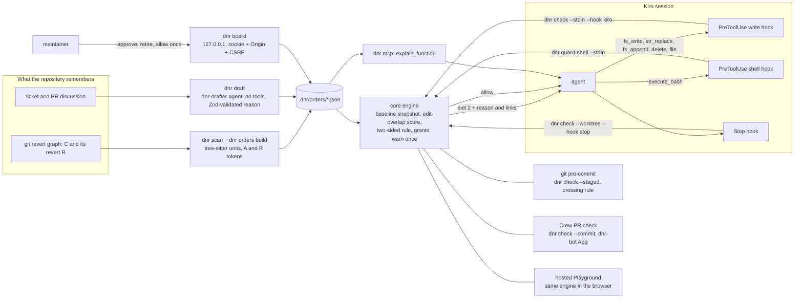

# Architecture

DNR (Do Not Resurrect) turns a repository's reverts into do-not-resurrect orders and enforces them where an agent writes code. This page is the diagram the write-up links to; the normative detail is in `.kiro/specs/dnr-check/design.md` and `.kiro/specs/trial-harness/design.md`.

## Write path

## Layers

| Layer | Package | Notes |
|---|---|---|
| Schemas | `packages/schemas` | Zod 4, every boundary (plan §7) |
| Grammar | `packages/grammar` | web-tree-sitter loaders for node and the browser; grammars in `vendor/grammars/` |
| Engine | `packages/core` | isomorphic, no `node:*`: tokenize, qualname, diff, multiset, score, proximity, decide, stale, apply-tool |
| Git and state | `packages/git`, `packages/store` | temp-index baseline, blobs, revert discovery; orders, grants, sessions, `events.jsonl` |
| Hooks and CLI | `packages/hook`, `packages/cli` | the `dnr` binary that Kiro's hook files call |
| MCP | `packages/mcp` | two read-only tools |
| UI | `packages/ui`, `apps/playground`, `apps/board` | one React app, a localStorage adapter (Playground) and a local-API adapter (board) |
| Trial | `packages/trial`, `trial/agents/` | the pre-registered evaluation (plan §9) |

## Decision order

Every write is checked in the order **protect → match → warn → allow**. Protected paths (`.dnr/**`, `.kiro/hooks/**`, `.kiro/settings/**`, `.kiro/agents/**`, `~/.kiro/**`) are always denied. A match needs an edit-overlap score of at least τ (0.6 before tuning) and, when the order both adds and removes code, at least 30% of each side. A covered but non-matching write is warned once per order per session. Grants from allow-once or an approved `ask` let a fixed re-land through. Every internal error fails open.
